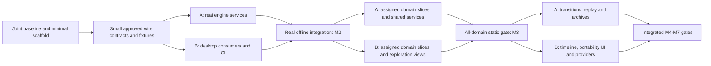

# Poliscope — Implementation Roadmap

Revision 0.2 · 2026-10-16 · Distributed delivery baseline: two developers, expandable to three; implementation has not started.

## 1. Purpose, authority, and document map

This roadmap translates the [global game design](design_doc.md) and [technical specification](tech_spec.md), both revision 0.2 dated 2026-10-13, into an executable delivery plan. Those documents define product and architecture requirements; this roadmap defines implementation order, work ownership, deliverables, dependencies, and evidence of completion. Where this plan proposes fixture contents, effort ranges, repository paths, or review procedures, those are planning decisions rather than additional claims made by the specifications.

**Repository baseline:** `7df9b2309a56c9bf96ceecdb41b24a5c5a51d873`. The repository contains specifications and planning documents. Application sources, dependency manifests, lockfiles, build scripts and tests are pending. README development commands define the target command interface. All implementation packages are **not started**; milestone and platform/provider validation is **unrun**.

| Document | Use |
|---|---|
| This roadmap | Scope, milestones, execution sequence, staffing, decisions, and release gates |
| [Distributed delivery plan](roadmap/distributed_delivery.md) | Two/three-developer assignments for all 68 packages, parallel waves, contract handoffs, async review, and integration rules |
| [Shared work packages](roadmap/work_packages.md) | WP-001–WP-056: platform, engine, storage, UI, content infrastructure, timeline, AI, portability, and delivery |
| [Domain work packages](roadmap/domain_work_packages.md) | DOM-01–DOM-12: concrete work and validation for every domain |
| [Verification and traceability](roadmap/verification_matrix.md) | Coverage of both specifications, integrated scenarios, test ownership, and release evidence |

**Delivery configuration:** two concurrent contributors, A and B, with an optional third contributor, C. WP-001 records named assignments, skills, availability, review windows and access. The two-contributor allocation includes implementation, model review, verification, integration and delivery coordination.

Read the roadmap first, then the relevant package and its prerequisites. A package ID identifies scope; its numerical position alone does not authorize starting it. Dependency fields are authoritative. Source references use **D §n** for the design document and **T §n** for the technical specification.

## 2. Product scope and completion contract

The delivery target is a local, single-player educational desktop sandbox in which a player can create a civilization, inspect any of twelve domains, preview and apply choices, understand shared consequences, experiment through time, branch and compare, and export their work. The complete target includes optional BYOK assistance with first-class OpenRouter support. An offline milestone is an intermediate delivery, not permission to omit AI from the complete product.

The following constraints apply to every package and review:

1. **Player agency:** no assigned goals, default civic policies, hidden objective function, campaign progression, automatic redesign, or winner ranking. An explicitly selected reference civilization may supply labeled historical choices; an ordinary new sandbox may not.
2. **One world:** shared people, assets, resources, time, rights, obligations, and institutions have canonical identities. Domains contribute definitions and mechanisms without maintaining independent copies or spending shared capacity twice.
3. **Python authority:** Python owns arithmetic, allocation, transitions, numeric comparisons, goal observations, cost aggregation, and SQLite writes. TypeScript handles presentation, process boundaries, and provider protocols.
4. **Honest claims:** distinguish numerical/procedural/qualitative/partial/unsupported modeling, source/evidence status, and authored/imported/player/AI origin. Unknown is not zero; partial coverage is not whole-system sufficiency.
5. **Explicit assumptions:** no invented universal legitimacy, happiness, fairness, or cohesion meters. Every behavioral effect needs a declared population, rule, time basis, evidence, uncertainty, and validity limits.
6. **Reversible inquiry:** immutable committed states, pure previews, stale apply rejection, idempotent recovery, preserved alternate futures, and explicit model migration. Counterfactual redesign and a future effective policy change remain separate.
7. **Offline ownership:** authored interviews, simulation, history, exploration, and reports work without accounts or provider access. No background civilization upload. Keys are excluded from engine state, logs, saves, prompts, and exports.
8. **Desktop boundaries:** Electron main owns lifecycle, filesystem dialogs, key protection, and provider networking; sandboxed renderer uses a named preload API. One Python child communicates through bounded versioned stdio messages, not a web backend.
9. **Accessible inquiry:** core actions work by keyboard, visual status has text, graphs/matrices have list or table equivalents, and results identify civilization, scope, branch, revision/time, and model.
10. **Complete architecture, bounded models:** all twelve domains and the source map's branches must be represented. Release scope names which mechanisms are implemented and which remain explicit gaps. Completing one representative mechanism per domain is a minimum integration condition, not evidence that an entire society is numerically modeled.

Explicit exclusions from this roadmap are multiplayer, competing playable empires, a persistent cloud service, mandatory 3D terrain, individual-agent simulation at civilization scale, arbitrary imported/generated code execution, and paid live-provider tests in ordinary CI. The named-target capacity-bound calculation is included as an optional model capability; it cannot become a hidden social optimizer.

## 3. Delivery strategy and milestone gates

Organize work around separately owned engine and desktop streams, joined by small versioned contracts. Stabilize each needed contract before its consumers implement that boundary; do not wait for the entire engine or contract inventory before desktop work begins. Prove the offline choice-to-consequence loop with a deliberately small, labeled test fixture. Expand through a shared domain framework; do not implement twelve separate simulators. Introduce time after static state, accounts, and history are reliable. Start provider and packaging work early enough to expose platform constraints, but accept them only with integrated evidence.

The planning fixture for the early vertical slice is a small resource/service arrangement with two locations, overlapping membership/jurisdiction, finite shared labor and stock, an institution, and an unresolved alternative. It is synthetic test data with documented arithmetic, not a canonical civic policy or required player starting scenario. The education relationship path in D §5.7 is later used as an integration test across all domains, not as a mandated gameplay entry point.

| Milestone | Scope and work packages | Entry | Exit evidence |
|---|---|---|---|
| **M0 — Implementation baseline** | WP-001 | Specifications available | Requirement ledger, ownership, release coverage policy, decisions and risks recorded; source contradictions identified |
| **M1 — Trustworthy desktop/runtime foundation** | WP-002–WP-011 | M0 assignments and minimum scaffold; development overlaps by §3.1 | Frozen install and generated contracts work; secure desktop launches Python, handshakes, opens local storage, recovers from child failure; native packaging feasibility recorded |
| **M2 — Offline design vertical slice** | WP-012–WP-024 | M1 for integrated acceptance; contract-backed implementation starts during M1 | Create → inspect → preview → apply → trace → undo/fork → compare → close/reopen works offline with independently checked shared accounts; stale/duplicate requests are safe |
| **M3 — Twelve-domain design workspace** | WP-025–WP-032 and DOM-01–DOM-12 | M2 for integrated acceptance; pack/domain preparation can start earlier | All twelve modules and source branches registered; each has reviewed executable behavior plus honest gaps; atlas, matrices, world, evidence and distribution views navigate the same world; all-domain static integration passes |
| **M4 — Time, uncertainty, and experiments** | WP-033–WP-038; transition portions of all domain packages | M2 for generic time framework; M3 for integrated acceptance | Schedule/advance/cancel/replay/fork/compare works; shared transition reduction, multirate boundaries, lifecycle, hazards, deterministic streams and uncertainty semantics verified |
| **M5 — Portable local ownership** | WP-039–WP-041 | M2 for design export; M4 for complete experiment archive | Full-state round trips, safe rejection, privacy defaults, reports/CSV, backup/migration, and historical read-only behavior pass with no silent recomputation |
| **M6 — Complete optional AI/BYOK** | WP-042–WP-050 | M1 for provider infrastructure; M2 for proposal flow; M3/M4/M5 for full integrated acceptance | Full provider capability matrix exercised, grounded tools cannot commit, context consent and costs are visible, mock failures are safe, bounded authorized live checks have explicit outcomes |
| **M7 — Release candidate and native distribution** | WP-051–WP-056 | Earlier milestone evidence integrated | Performance and accessibility budgets met; recovery and security checks pass; Windows x64, macOS arm64/x64 and Linux x64 packages work without system Python; release evidence and limitations are published with artifacts |

Milestone exits are conjunctive: passing a UI demo does not waive arithmetic or storage evidence. M7 requires M3, M4, M5, and M6, including all domain packages. A milestone remains blocked if a required behavior is untested or an unexplained failure remains. A scoped preview may be released earlier only with its omissions explicit; it must not be labeled complete architecture delivery.

### 3.1 Parallel execution and acceptance dependencies

Milestones define integrated acceptance gates. The following waves allocate work for two contributors; the [distributed delivery plan](roadmap/distributed_delivery.md) specifies child handoffs, package ownership and the three-contributor allocation. Child work starts when its declared inputs are ready. Open acceptance items remain attached to their milestone.

| Wave / gate | Developer A — engine, persistence and shared computation | Developer B — desktop, delivery and institutional content | Handoff / integration evidence |
|---|---|---|---|
| W0 / M0 | Requirements, numerical/model inventory, Python scaffold design | Delivery ledger, JS scaffold design, runner/access inventory | Joint ownership/availability map, ready backlog and minimal bootstrap contract |
| W1 / M1 | WP-002 Python child; WP-005 minimum wire fixtures; WP-006–009 and Python side of WP-010 | WP-002 JS child; WP-003 CI; WP-004 packaging; TS side of WP-010 and WP-011 against fixtures | Real handshake early, then real storage; secure installed-process probe; both clean machines reproduce setup |
| W2 / M2 | WP-012–018: registry, accounts, evaluation, traces, history; producer support for WP-019/023 | WP-020–022: shell/interviews/indicators and WP-023 UI against approved fixtures; WP-019 independent fixtures and WP-024 acceptance | Replace fixtures operation by operation; weekly real child/database slice; offline M2 gate |
| W3 / M3 | WP-027 harness; A-owned domain children; Python projections for WP-028–031 | B-owned domain children; WP-028–031 views; WP-025/026 content tooling in reserved blocks | Two active domain slices maximum; pair tests continuously; WP-032 accepts all twelve static domains |
| W4 / M4 | WP-033–036, WP-038 and A-owned transitions; archive format sketch for WP-039 | WP-037 timeline against fixtures, B-owned transitions, provider-key/mock preparation WP-042/043 in reserved blocks | Atomic boundary/replay contracts precede timeline integration; all selected domain transitions pass |
| W5 / M5 | WP-039–041 engine/archives/migrations; Python parts of WP-046/048 when ready | WP-039–041 dialogs/report UI; WP-042–045 provider work after portability review capacity is reserved | Fresh-directory round trip and recovery; provider work cannot displace M5 counterpart reviews |
| W6 / M6 | WP-046 context/tools, WP-048 costs, persistence support for WP-047/049; cross-review provider behavior | WP-044–050 adapters/streams/modalities/settings and compatibility evidence | Mock failures and grounded proposal loop integrated; separately authorized bounded live outcomes |
| W7 / M7 | WP-051 measured engine fixes, WP-052/053 audits, numerical/model checks, native replay support | Desktop accessibility/security fixes, WP-054 artifacts, WP-055/056 evidence and delivery | Frozen candidate passes full product/native/provider requirements; both developers sign evidence they independently checked |

Wave entries define per-contributor queues. Each contributor may have one implementation child and one review in progress. W3 allocates B's capacity between domain mechanisms, content tooling and UI. W4/W5 provider preparation follows current-gate implementation and review commitments. Packaging feasibility begins in W1.



The probable computation critical path remains accounts → evaluation → transactional apply → domain coupling → atomic transitions/replay → portable experiments. The delivery critical path also includes reviewer availability, contract turnaround, B's domain/UI/provider queue, runner availability and model evidence. Forecast each resource separately. Adding C removes specific content/integration work from A/B; it cannot remove causal dependencies or justify dividing effort by three.

### 3.2 Work can start before a parent package is accepted

A `Depends` field in the package register is an **acceptance dependency**. Starting implementation requires either the verified dependency or a reviewed, merged contract/fixture child covering that boundary. Such a child has its own ID, owner, reviewer, exact upstream commit and unavailable behaviors. The producer and consumer can then implement in parallel. A mock cannot authorize schema invention, scientific claims, persistence acceptance or milestone completion.

WP-002, WP-003, WP-005, WP-010, WP-018, WP-023, WP-027, WP-034, WP-039, WP-046 and WP-048 need early boundary children. The distributed plan defines the bootstrap sequence and consumer start criteria. Integrate each desktop operation with its production engine service when that service becomes available. Milestone acceptance requires the integrated services.

## 4. Work package execution rules

Each package has exactly one accountable developer slot and a different peer reviewer, plus required specialties, dependency IDs, size class, outputs/actions, and testable acceptance criteria. The assignment matrix allocates all specialties within each staffing configuration. Domain packages have separate **start prerequisites** and **integration acceptance dependencies** to avoid circular scheduling. References to another domain's interface do not authorize writing its state directly.

Use the following lifecycle in the issue tracker when implementation starts: `not started` → `ready` → `in progress` → `review` → `verified`, with `blocked` carrying a named prerequisite and owner. Do not infer completion from merged code alone. Link each implementation issue/PR to its package, source sections, affected contract versions, tests, evidence, and any remaining model gaps. This roadmap creates no external issues or assignments.

**Ready checklist:** prerequisites verified or an explicit reviewed and merged contract child exists; accountable owner, peer reviewer, affected paths, inputs/outputs and upstream SHA agreed; evidence/fixture available; data ownership settled; package acceptance can fail for the relevant broken behavior. A stub permits development, not milestone acceptance.

**Common definition of done:**

- Deliverables implemented in the agreed repository area; exact dependencies/locks and generated artifacts updated where necessary; no secrets or personal data committed.
- Existing meaningful tests plus package-specific positive, incomplete/conflict, and failure cases pass; test counts and skips are recorded. Expected failures remain distinct from passes.
- Boundary and schema changes regenerate contracts and document compatibility/migration. Numeric expectations have independent derivations; UI snapshots alone do not establish correctness.
- Traceability identifies source/assumption/model status; core functionality remains offline; accessibility and privilege boundaries are preserved.
- Documentation covers usage, limitations, and recovery; evidence links are attached; independent reviewer accepts the behavior and scope. An author does not self-certify empirical validity.

**Package split rule:** split parents into reviewable children of roughly one to three focused implementation days, and split any L package before implementation. Limit each PR to one behavior or boundary change. Preserve parent ID, dependency edges, acceptance criteria, and integration responsibility. Cross-language parents allocate producer and consumer children to A and B, with one parent integration owner. Common reusable work must be implemented once and referenced by domains.

Use independent clones/worktrees and private user-data databases per developer/agent. Before editing, claim a child and its paths in the shared ledger. Follow the distributed plan for asynchronous handoffs, next-working-period review, compatibility windows, shared-file coordination and candidate checks. These controls are included in the common definition of done.

## 5. Repository and command plan

WP-002 establishes the concrete layout and script wiring. The following are responsibility boundaries, not claims that files already exist:

```text
desktop/main/         lifecycle, process bridge, files, keys, providers
desktop/preload/      named and validated renderer API
desktop/renderer/     synchronized React workspaces and accessible components
engine/world/         identities, scopes, population, institutions, shared accounts
engine/domains/       twelve registered modules
engine/simulation/    graph evaluation, allocation, solvers, transitions, randomness
engine/storage/       SQLite, revisions, experiments, backup and migration
engine/explanation/   measurements, findings, traces and context assembly
content/              manifests, catalogs, evidence, reviewed mechanisms and fixtures
contracts/            generated schemas, TypeScript bindings and compatibility fixtures
tests/                cross-boundary, numerical, desktop, provider and native tests
docs/                 architecture, roadmap, decisions, model reviews and user guidance
```

Use Node 24 LTS, Python 3.12, uv, npm's committed lockfile, Pydantic 2, Decimal, Electron/Forge/Vite, React/TypeScript, TanStack Query, Recharts, SQLite, and PyInstaller. Select mutually compatible supported stable dependency releases in WP-002 and pin them; this roadmap does not guess exact future release numbers.

WP-002/WP-003 must make the README workflow executable from the repository root:

```sh
npm ci
uv sync --frozen --python 3.12
npm run dev
npm run content:validate
npm run contracts:check
npm run typecheck
uv run --frozen pytest
npm test
npm run test:desktop
npm run package
```

The development command launches Electron and its managed Python engine. It must not introduce an application HTTP backend. Development tooling may use Vite's own supported development transport; runtime model IPC remains stdio. Default test commands use synthetic data and provider mocks, never paid API calls. Native packaging runs on each target OS/architecture. Any auxiliary benchmark, live-provider, or signing command must be documented when introduced and have a distinct explicit invocation.

## 6. Two-developer capacity and three-developer expansion

| Slot | Default accountability | Peer review and backup | With C present |
|---|---|---|---|
| **A** | Python world, shared contracts, arithmetic, storage/history, transitions, context/cost authority; assigned material/service domains | B reviews A's changes and independently derives selected expected results | Remains engine steward; transfers the listed content/health/gate parents to C |
| **B** | Electron/main/preload/React, CI/native delivery, provider adapters, delivery ledger; assigned institutional domains | A reviews B's changes and audits trust/quantity boundaries | Remains desktop steward; transfers content/gate work and three domains to C, takes risk domain from A |
| **C, optional** | Only after actual onboarding: content/evidence build, assigned domains and cross-stream integration evidence | A/B remain peers for C; C reviews selected A/B work | WP-008/019/025/026/032/052/055/056 and DOM-05/06/07/11 as listed in the assignment matrix |

A/B denote contributor assignments. Record ownership changes in the delivery ledger before transferring work. Architecture, engine, desktop, model review, quality/security, planning and product review are allocated responsibilities. B maintains dependencies and status; A maintains numerical and architecture decisions. Both review scope and evidence. Product changes require a recorded decision against the specifications.

A and B review each other's code and independently verify numerical expectations. Model records distinguish hypothetical educational assumptions from supported empirical claims. Required expertise or native execution capacity unavailable within the team is recorded as an external prerequisite and blocks the affected acceptance item.

The delivery workflow supports non-overlapping working hours. WP-001 records IANA time zones, weekly availability, leave, review windows and access. Contracts, decisions, review requests and handoffs are recorded asynchronously in the shared ledger. Synchronous meetings are optional.

For initial forecasting, package size classes are **S = 1–3**, **M = 4–7**, **L = 8–12 focused engineer-days**. These are explicitly provisional planning envelopes for implementation plus local tests/review corrections, not commitments or empirical estimates. Every domain package is L because evidence, interfaces, content, and fixtures must be integrated. Independent domain research, scientific review, signing procurement, provider credits/access, and platform availability are separate lead-time risks; unknown research cannot be disguised as ordinary coding effort.

WP-001 must turn the package inventory and the complete A/B/C assignment matrix into a resource-loaded forecast after owners inspect representative contracts and model sources. Sum package ranges for effort; do not divide by headcount to claim a delivery date. Schedule using dependency order, actual staffing, review capacity, integration time, platform lead times, and a separately visible uncertainty allowance. Reforecast after M1 and M2 using observed completion rates. No calendar completion date is supportable from this documentation-only baseline.

The following roll-up sums the provisional package size classes. It represents implementation effort; calendar forecasts require the resource-loading process below. Domain effort is counted once across M3/M4; it is not included again in the shared-framework rows. Package ranges include local tests/review corrections, while independent research, external waiting time and portfolio contingency remain outside these totals.

| Work stream | Packages / size mix | Provisional focused engineer-days |
|---|---|---|
| M0 baseline | WP-001; 1 M | 4–7 |
| M1 foundation | WP-002–WP-011; 9 M + 1 L | 44–75 |
| M2 offline loop | WP-012–WP-024; 5 M + 8 L | 84–131 |
| M3 shared content/exploration | WP-025–WP-032; 4 M + 4 L | 48–76 |
| All-domain implementation across M3/M4 | DOM-01–DOM-12; 12 L | 96–144 |
| M4 shared time/uncertainty | WP-033–WP-038; 3 M + 3 L | 36–57 |
| M5 portability/recovery | WP-039–WP-041; 1 M + 2 L | 20–31 |
| M6 optional assistance/provider completeness | WP-042–WP-050; 2 M + 7 L | 64–98 |
| M7 hardening/release | WP-051–WP-056; 1 M + 5 L | 44–67 |
| **Total initial package envelope** | **68 packages; 26 M + 42 L** | **440–686** |

Record model research as separate child work when evidence or algorithms are unavailable. Include its effort, prerequisites and uncertainty in the forecast while retaining the required release behavior in the scope register.

Plan each person's available week initially as **60% implementation/local verification, 20% peer review and corrections, 10% cross-stream integration, 10% handoffs/decisions/triage**. These provisional capacity buckets sum to 100% and apply to two or three people; measure and adjust them after W1. The 440–686 day envelope includes local testing and review corrections. Reclassify these activities when estimating children to prevent double counting. Estimate independent peer review, cross-environment integration, coordination and research explicitly. Calendar duration is calculated from dependencies and contributor availability.

Produce separate two- and three-person forecasts from child effort, actual hours available, dependencies, assigned reviewer queues, expected next-working-period response, native lead times and research unknowns. Include a visible uncertainty reserve; do not fill every available hour with feature work. Report the current bottleneck, ready-work coverage and review wait separately from coding effort. Reforecast after W1/M1, M2, every two weeks thereafter, and when C joins or availability changes. No credible calendar completion date exists until those inputs are measured.

C joins from a clean checkout, reproduces setup, runs the contract/harness checks, completes a small reviewed change and accepts the transferred queues. Transfer parent accountability after its current child merges; there is never a partially shared owner. Until then A/B remain accountable. If C is unavailable or leaves, the matrix's two-person assignment resumes and the forecast changes; scope and release requirements stay visible.

### 6.1 Initial performance fixtures and budgets

These are proposed engineering acceptance targets to make DEC-06 actionable, not requirements asserted by the source documents or measured capabilities. WP-001 confirms the reference machine and records any justified changes; WP-019 gathers the first measurements. Rebaseline transparently if the selected models require different scales. Never meet a latency target by skipping required calculation/transition boundaries or concealing solver failure.

Use a native reference desktop with four modern CPU cores, 16 GiB RAM and SSD storage; record exact hardware/OS and power settings. Run cold and warm caches separately, with at least 30 independent preview/query samples and labeled workload/model identities. Network latency and upstream generation time are excluded from local UI/engine targets and reported separately.

| Fixture or operation | Initial workload / target |
|---|---|
| Small classroom world | 20 scopes, 40 cohorts, 100 assets, 300 decision instances, 2,000 active typed edges; all twelve domains and explicit overlap |
| Larger exploratory world | 200 scopes, 400 cohorts, 1,000 assets, 3,000 decision instances, 30,000 active typed edges; sparse graph with declared representative coupled components |
| Long-history/trace fixture | 1,000 committed revisions, 20 named branches, 100,000 pageable trace nodes; do not materialize all records in one renderer response |
| Local static preview | p95 ≤1 second small / ≤5 seconds larger; cold versus warm figures recorded independently; expensive solver components have separately declared budgets/status |
| Visible atlas/matrix/world page | p95 ≤300 ms warm query for a page of at most 100 records; scale through pagination rather than complete-world rendering |
| Immediate UI feedback | p95 ≤200 ms for selection/navigation/cancel acknowledgement while work is running; slow computation uses visible progress |
| Cancellation and chunk boundary | Confirm cancellation or a bounded in-progress boundary status within 1 second; retain last committed state; separately measure actual boundary completion |
| Dynamic run | Complete a deterministic 365-day small fixture within 30 seconds on the reference machine, executing every required boundary; large/stochastic run throughput reported separately |
| Memory and transport | Combined main/renderer/engine peak ≤2 GiB on the larger fixture; 1 MiB IPC message limit remains mandatory; oversized traces/archives are chunked |

Reference fixture arithmetic, solver structure and transition complexity must be fixed/versioned so these counts cannot hide a trivial workload. Native targets also run correctness/replay checks regardless of performance differences. Changes to accepted budgets require an explicit decision and forecast impact, not an unreported waiver after a failed run.

## 7. Decision register before and during implementation

These decisions need an owner and recorded resolution, not a new round of stack selection. Development may proceed on independent packages while an external prerequisite is unresolved.

| Decision | Owner / due | Default or required outcome | Blocks if unresolved |
|---|---|---|---|
| DEC-01: exact dependency versions and platform support floor | B, reviewed by A / WP-002, WP-004 | Supported compatible stable releases, exact locks; documented OS/version matrix | Reproducible installs and native acceptance |
| DEC-02: canonical serialization, IDs, calendar, RNG and numeric identity | A, reviewed by B / WP-005, WP-006, WP-033, WP-035 | Decimal 28 digits/half-even as specified; explicit canonical and day-boundary rules; versioned RNG | Digests, replay, cross-platform reproduction |
| DEC-03: source inventory and redistribution license | B (C when active), reviewed by A / WP-025 | Pin society source at stated revision initially; inspect actual licenses and amendment lineage; permission recorded | Distribution of imported excerpts or packs, not synthetic framework work |
| DEC-04: initial released model inventory | B (C for WP-026 when active), reviewed by A / WP-001, refined WP-026 | All branches classified; every domain has substantive reviewed behavior; enumerate numerical/procedural/qualitative/gap coverage | M3 content acceptance and truthful release claims |
| DEC-05: supported solver/allocation procedures | A, reviewed by B / WP-014, WP-015 | Explicit policy-neutral implementation, limits, applicability and independent fixtures | Coupled model activation |
| DEC-06: expected world sizes and performance budgets | A, reviewed by B / WP-001, measured WP-019 | Confirm or explicitly revise §6.1's fixture/hardware/latency/memory targets and freeze benchmark definitions | WP-051 acceptance; no undefined “fast enough” gate |
| DEC-07: native signing/notarization and runner availability | B, reviewed by A / WP-004, WP-054 | Windows x64, macOS arm64/x64, Linux x64 native execution; signing assets kept outside source | Signed/public native release where required |
| DEC-08: provider compatibility and live validation | B, reviewed by A (C for WP-050 when active) / WP-043–WP-050 | Current official OpenRouter schemas, explicit capability table, bounded authorized live test plan | Full OpenRouter compatibility claim; offline work remains independent |
| DEC-09: privacy defaults and runtime safeguards | A, reviewed by B / WP-039, WP-046, WP-048 | Private content excluded by default; explicit sharing; named archive/context/tool/solver limits | Import/sharing/budget acceptance |
| DEC-10: source document cross-link cleanup | B / roadmap revision | Companion links repaired to existing files; no specification semantics changed | Resolved documentation maintenance |
| DEC-11: actual staffing, review coverage and access | B coordinates, A reviews / WP-001; repeat when C joins | Fill A/B names, IANA zones, hours, review windows, backup and runner/repository access; apply complete two/three-person matrix | Resource-loaded dates and unassigned starts |
| DEC-12: contract compatibility and merge controls | A proposes, B reviews / WP-003/005 | Define supported producer/consumer version window, fixture ownership, required candidate CI and migrations; test both independent clones | Parallel consumer starts and boundary-changing merges |

## 8. Risk register and response

| Risk | Early detection | Response / accountable package |
|---|---|---|
| Review stalls across time zones | Review waits exceed next working period, no independent ready child | Reserve peer capacity, smaller PRs, written decisions, one ready fallback per developer; WP-001/003 and distributed plan |
| Concurrent changes break contracts/shared files | Both branches alter schema, migration, registry or lock without coordination | Named steward/backup, contract-first merge, additive window, regenerate and test candidate against current main; WP-005/009/027 |
| Unallocated review or integration work | Model, verification or integration tasks lack a named assignee or exceed contributor capacity | Every package has A/B owner/reviewer; cap WIP, resource-load domain/UI/provider work, transfer only when C is active; WP-001 |
| Agent tasks collide or duplicate mechanisms | Agents edit same paths or treat private branches as authoritative | Claim child/path scope, isolated worktree, shared ledger and ordinary PR/contract checks; accountable developer reviews agent work |
| Framework becomes a resource-only simulator | Institutional domains have only prose, no procedures or capacity fixtures | Require governance, rights, care, identity and communication behavior; DOM-03/04/05/09/11 and WP-032 |
| Duplicate world state or double allocation | Same asset/population represented with multiple spendable IDs | Canonical ownership registry, overlap fixtures, combined reducers; WP-007/015/027/034 |
| Source prose is mistaken for validated science | Imported range converted to mean, adopted choice treated as fact | Separate origin/evidence/coverage axes, independent numerical review, blocked activation; WP-008/025/026 |
| Graph cycles or policies silently resolved by order | Changing file order changes a result or political winner | SCC classification, solver contracts, explicit conflicts; WP-013/014 |
| History corruption or uncertain commit | Engine dies after database commit before IPC response | Operation IDs, transactional head movement, query/recovery tests; WP-018/041/053 |
| Model/replay drift after changes | Matching UI bars hide changed inputs or random streams | Complete canonical identities, isolated RNG, archived models, native fixtures; WP-016/035/036/054 |
| Long model/research scope obscures progress | Domain labeled complete without evidence inventory | Time-box framework separately; record model gaps and named review work; domain exit contract and DEC-04 |
| Provider API/capabilities drift | Catalog metadata and request controls disagree | Refreshable timestamped catalog, supported control validation, current official schema checks; WP-043/044/050 |
| Paid retries or incorrect cost totals | Uncertain completion retried; estimate and actual both charged | Deliberate generation retry, per-request reconciliation, unknown status; WP-045/048 |
| Desktop/native assumptions fail late | PyInstaller path, signing, credential backend or architecture mismatch | Early native probe plus full target matrix; WP-004/042/054 |
| AI/imported content crosses trust boundary | Tool exposes commit, generated formula executes, key leaks | Explicit operation allowlists, bounded data-only grammar, redaction and adversarial tests; WP-011/012/039/046/053 |
| Dense UI hides exclusions or local shortages | Aggregate looks sufficient while one unreachable group lacks service | Scope/distribution fixtures, text coverage labels, usability tasks; WP-022/029/030/052 |

B maintains risks and blocked-package records; A reviews technical impacts at each weekly integration checkpoint. With C active, C maintains integration evidence. These duties consume the capacity reserved above. A new requirement, model, or provider capability gets a source reference, owner, dependency impact, evidence plan, and forecast impact before entering active scope. Preserve work and source lineage; do not quietly weaken acceptance criteria to meet a date.

## 9. Verification, release, and immediate next work

The [verification matrix](roadmap/verification_matrix.md) is the release checklist. Required evidence comprises meaningful test runs with counts and skip reasons, independent arithmetic/model review, offline desktop tasks, provider capability/failure outcomes, safe round trips, native installation results, and bounded performance/accessibility results. Unit success cannot substitute for integrated behavior.

A release candidate freezes application/schema/catalog/model/numeric identities, exact locks, fixtures, pack digests, compatibility policy, and platform artifacts. The gate owner in the A/B/C assignment matrix records evidence and limitations; the different assigned peer reviews it. Both developers check architecture, model/evidence and player-agency criteria through the listed specialties; C takes designated gates only after onboarding. This is an implementation review process, not a claim that approvals have already occurred.

Release notes must distinguish code/model defects, unsupported model effects, unavailable historical recomputation, untested provider capabilities, and platform limitations. No key or private civilization is included in diagnostics. A known limitation may be disclosed in a preview; missing required architecture behavior blocks calling the complete product delivered.

W0 assigns B the delivery ledger and JavaScript/native-runner inventory, and A the model/contract risk inventory and Python bootstrap. After joint review of the layout and wire fixtures, merge WP-002's minimal scaffold and WP-003's initial checks. A implements the wire producer and core services; B implements the consumer, secure shell and packaging probe against the approved fixtures. Subsequent work follows the wave table and package assignments. M2 requires the integrated offline loop; complete delivery requires M7.
