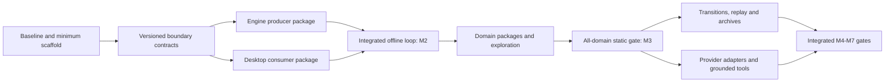

# Poliscope — Implementation Roadmap

Execution update (2026-10-17): WP-001 and G0/M0 planning acceptance are complete
under SV; see the [execution ledger](roadmap/execution/README.md). Application
gates remain open. Statements below describe the original planning baseline.

Revision 0.5 · 2026-10-16 · Development agents allocated at work-package boundaries; implementation has not started.

## 1. Purpose, authority, and document map

This roadmap plans delivery for Windows x64 and Linux x64 only and translates the [global game design](design_doc.md) and [technical specification](tech_spec.md), both revision 0.3 dated 2026-10-16, into an executable delivery plan. Those documents define product and architecture requirements; this roadmap defines implementation order, work ownership, deliverables, dependencies, and evidence of completion. Where this plan proposes fixture contents, effort ranges, repository paths, or review procedures, those are planning decisions rather than additional claims made by the specifications.

**Repository baseline:** `da1ee238fc0a30b6ca2bef0b861e070f42d140be`. The repository contains specifications and planning documents. Application sources, dependency manifests, lockfiles, build scripts and tests are pending. README development commands define the target command interface. All implementation packages are **not started**; milestone and platform/provider validation is **unrun**.

| Document | Use |
|---|---|
| This roadmap | Scope, milestones, execution sequence, staffing, decisions, and release gates |
| [Distributed delivery plan](roadmap/distributed_delivery.md) | Agent allocation at package boundaries, stable package execution, validation, handoffs and integration |
| [Shared work packages](roadmap/work_packages.md) | WP-001–WP-056: platform, engine, storage, UI, content infrastructure, timeline, AI, portability, and delivery |
| [Domain work packages](roadmap/domain_work_packages.md) | DOM-01–DOM-12: concrete work and validation for every domain |
| [Verification and traceability](roadmap/verification_matrix.md) | Coverage of both specifications, integrated scenarios, test ownership, and release evidence |

**Delivery configuration:** one to three development agents under human control. Agent availability is reassessed whenever a work package completes and before a ready package starts. Each package records its agent owner, controlling person, agreed division of work, validation route and acceptance contract at start; these remain stable through execution. Changes in available agents affect subsequent package allocations and leave other active packages unchanged. WP-001 establishes this process; the delivery ledger records each later allocation.

Read the roadmap first, then the relevant package and its prerequisites. A package ID identifies scope; its numerical position alone does not authorize starting it. Dependency fields are authoritative. Source references use **D §n** for the design document and **T §n** for the technical specification.

## 2. Product scope and completion contract

The delivery target is a local, single-player educational desktop sandbox in which a player can create a civilization, inspect any of twelve domains, preview and apply choices, understand shared consequences, experiment through time, branch and compare, and export their work. The complete target includes optional BYOK assistance with first-class OpenRouter support. An offline milestone is an intermediate delivery, not permission to omit AI from the complete product.

The following constraints apply to every package and review:

1. **Player agency:** no assigned goals, default civic policies, hidden objective function, campaign progression, automatic redesign, or winner ranking. An explicitly selected reference civilization may supply labeled historical choices; an ordinary new sandbox may not.
2. **One world:** shared people, assets, resources, time, rights, obligations, and institutions have canonical identities. Domains contribute definitions and mechanisms without maintaining independent copies or spending shared capacity twice.
3. **Python authority:** Python owns arithmetic, allocation, transitions, numeric comparisons, goal observations, cost aggregation, and SQLite writes. TypeScript handles presentation, process boundaries, and provider protocols.
4. **Honest claims:** distinguish numerical/procedural/qualitative/partial/unsupported modeling, source/evidence status, and authored/imported/player/AI origin. Unknown is not zero; partial coverage is not whole-system sufficiency.
5. **Explicit assumptions:** no invented universal legitimacy, happiness, fairness, or cohesion meters. Every behavioral effect needs a declared population, rule, time basis, evidence, uncertainty, and validity limits.
6. **Reversible inquiry:** immutable committed states, pure previews, stale apply rejection, idempotent recovery, preserved alternate futures, and explicit model migration. Counterfactual redesign and a future effective policy change remain separate.
7. **Offline ownership:** authored interviews, simulation, history, exploration, and reports work without accounts or provider access. No background civilization upload. Keys are excluded from engine state, logs, saves, prompts, and exports.
8. **Desktop boundaries:** Electron main owns lifecycle, filesystem dialogs, key protection, and provider networking; sandboxed renderer uses a named preload API. One Python child communicates through bounded versioned stdio messages, not a web backend.
9. **Accessible inquiry:** core actions work by keyboard, visual status has text, graphs/matrices have list or table equivalents, and results identify civilization, scope, branch, revision/time, and model.
10. **Complete architecture, bounded models:** all twelve domains and the source map's branches must be represented. Release scope names which mechanisms are implemented and which remain explicit gaps. Completing one representative mechanism per domain is a minimum integration condition, not evidence that an entire society is numerically modeled.

Explicit exclusions from this roadmap are multiplayer, competing playable empires, a persistent cloud service, mandatory 3D terrain, individual-agent simulation at civilization scale, arbitrary imported/generated code execution, and paid live-provider tests in ordinary CI. The named-target capacity-bound calculation is included as an optional model capability; it cannot become a hidden social optimizer.

## 3. Delivery strategy and milestone gates

Organize work around engine, desktop and content/integration boundaries joined by small versioned contracts. One agent executes ready packages sequentially; two or three agents can execute compatible ready packages concurrently. Allocate agents per package rather than reserving engine, desktop or content roles for the project. Stabilize each needed contract before its consumers implement that boundary; do not wait for the entire engine or contract inventory before desktop work begins. Prove the offline choice-to-consequence loop with a deliberately small, labeled test fixture. Expand through a shared domain framework; do not implement twelve separate simulators. Introduce time after static state, accounts, and history are reliable. Start provider and packaging work early enough to expose platform constraints, but accept them only with integrated evidence.

The planning fixture for the early vertical slice is a small resource/service arrangement with two locations, overlapping membership/jurisdiction, finite shared labor and stock, an institution, and an unresolved alternative. It is synthetic test data with documented arithmetic, not a canonical civic policy or required player starting scenario. The education relationship path in D §5.7 is later used as an integration test across all domains, not as a mandated gameplay entry point.

| Milestone | Scope and work packages | Entry | Exit evidence |
|---|---|---|---|
| **M0 — Implementation baseline** | WP-001 | Specifications available | Requirement ledger, ownership, release coverage policy, decisions and risks recorded; source contradictions identified; leaf requirement IDs and explicit milestone subcase manifests recorded |
| **M1 — Trustworthy desktop/runtime foundation** | WP-002–WP-011 | M0 allocation process and minimum scaffold; development overlaps by §3.1 | Frozen install and generated contracts work; secure desktop launches Python, handshakes, opens local storage, recovers from child failure; native packaging feasibility recorded |
| **M2 — Offline design vertical slice** | WP-012–WP-024 | M1 for integrated acceptance; contract-backed implementation starts during M1 | Create → inspect → preview → apply → trace → undo/fork → compare → close/reopen works offline with independently checked shared accounts; stale/duplicate requests are safe |
| **M3 — Twelve-domain design workspace** | WP-025–WP-032 and DOM-01–DOM-12 | M2 for integrated acceptance; pack/domain preparation can start earlier | All twelve modules and source branches registered; each has reviewed executable behavior plus honest gaps; atlas, matrices, world, evidence and distribution views navigate the same world; all-domain static integration passes |
| **M4 — Time, uncertainty, and experiments** | WP-033–WP-038; transition portions of all domain packages | M2 for generic time framework; M3 for integrated acceptance | Schedule/advance/cancel/replay/fork/compare works; shared transition reduction, multirate boundaries, lifecycle, hazards, deterministic streams and uncertainty semantics verified |
| **M5 — Portable local ownership** | WP-039–WP-041 | M2 for design export; M4 for complete experiment archive | Full-state round trips, safe rejection, privacy defaults, reports/CSV, backup/migration, and historical read-only behavior pass with no silent recomputation |
| **M6 — Complete optional AI/BYOK** | WP-042–WP-050 | M1 for provider infrastructure; M2 for proposal flow; M3/M4/M5 for full integrated acceptance | Full provider capability matrix exercised, grounded tools cannot commit, context consent and costs are visible, mock failures are safe, bounded authorized live checks have explicit outcomes |
| **M7 — Release candidate and native distribution** | WP-051–WP-056 | Earlier milestone evidence integrated | Performance and accessibility budgets met; recovery and security checks pass; Windows x64 and Linux x64 packages work without system Python; release evidence and limitations are published with artifacts |

Milestone exits are conjunctive: passing a UI demo does not waive arithmetic or storage evidence. M7 requires M3, M4, M5, and M6, including all domain packages. A milestone remains blocked if a required behavior is untested or an unexplained failure remains. A scoped preview may be released earlier only with its omissions explicit; it must not be labeled complete architecture delivery.

### 3.1 Ready work and agent allocation

Milestones group acceptance evidence; they do not reserve agents or require a common staffing level. The ready queue follows package dependencies and validated boundary contracts. At each package completion, publish its evidence, release that package's agent capacity and select the next compatible ready package using current availability. Each active package retains its existing assignment. Unrelated packages can continue while a completed package's next allocation changes from one to two or three agents, or back again.

| Milestone | Candidate work areas | Required integration |
|---|---|---|
| M0 | Requirement ledger, model/coverage decisions, allocation process and access inventory | Measurable scope, ready-package definitions and allocation records |
| M1 | Minimum scaffold/CI, wire contract, engine producer, desktop consumer, world/storage and native probes | Actual handshake, secure process/storage and clean setup |
| M2 | Registry/accounts/evaluation/history services and their interview/indicator/comparison consumers | Offline create → preview → apply → trace → fork → reopen |
| M3 | Content build, domain harness, ready domain mechanisms and exploration projections/views | Incremental counterpart tests and all twelve static domains |
| M4 | Calendar, atomic reduction, replay, selected domain transitions and timeline views | Atomic boundaries and reproducible experiments |
| M5 | Archive contract/validation, file dialogs, reports and migration/recovery | Privacy-safe fresh-directory round trip |
| M6 | Provider adapters, context/tools, cost records and assistant UI | Grounded proposals, failure isolation and authorized compatibility evidence |
| M7 | Measured fixes, accessibility/security/model checks, native packages and final audit | Frozen-candidate product/platform/provider gates |

With one available agent, select the next ready package on the integration path. With two or three, select additional ready packages with compatible contracts and nonoverlapping write scopes; reserve package review/integration capacity. Producer and consumer packages can run concurrently after their shared contract is validated. Packaging probes and provider research enter the queue early enough to expose external lead times. Domain/UI work proceeds through integrated slices.



The dependency graph and package contracts are stable across agent-count changes. Elapsed duration follows ready work, actual agent capacity, review/integration effort, controller availability and external prerequisites. No milestone requires the same agent lineup as the previous milestone.

### 3.2 Work can start before a parent package is accepted

A `Depends` field in the package register is an **acceptance dependency**. Starting implementation requires either the verified dependency or a reviewed, merged contract/fixture child covering that boundary. Each executable package has its own ID, owner, controller, validation route, exact upstream commit and unavailable behaviors. Producer and consumer packages execute sequentially or concurrently as allocated at their respective starts. Contract approval follows the package validation route in the delivery plan. A mock cannot authorize schema invention, scientific claims, persistence acceptance or milestone completion.

WP-002, WP-003, WP-005, WP-010, WP-018, WP-023, WP-027, WP-034, WP-036, WP-039, WP-046 and WP-048 need early boundary children. Delivery §4.1 fixes the early production reader, world creation, boundary-store, sharing-envelope and spending-reservation slices so their consumers do not depend on a later integration parent. The distributed plan defines the bootstrap sequence and consumer start criteria. Integrate each desktop operation with its production engine service when that service becomes available. Milestone acceptance requires the integrated services.

## 4. Work package execution rules

Each executable package has one accountable development agent, a controlling person, a defined division of work and a validation route fixed at start. Required specialties describe capabilities; they do not identify permanent agents. Scope, interfaces, dependencies and acceptance criteria define the package contract. Domain packages distinguish development-start prerequisites from counterpart acceptance dependencies. Another agent can own the next package in the same component after the current package completes.

Use the following lifecycle in the issue tracker when implementation starts: `not started` → `ready` → `in progress` → `review` → `verified`, with `blocked` carrying a named prerequisite and owner. Do not infer completion from merged code alone. Link each implementation issue/PR to its package, source sections, affected contract versions, tests, evidence, and any remaining model gaps. This roadmap creates no external issues or assignments.

**Ready checklist:** prerequisites verified or an explicit reviewed and merged contract child exists; agent owner and controller, agreed division of work, validation route, affected paths, inputs/outputs and upstream SHA recorded; evidence/fixture available; data ownership settled; package acceptance can fail for the relevant broken behavior. A stub permits development, not milestone acceptance.

**Common definition of done:**

- Deliverables implemented in the agreed repository area; exact dependencies/locks and generated artifacts updated where necessary; no secrets or personal data committed.
- Existing meaningful tests plus package-specific positive, incomplete/conflict, and failure cases pass; test counts and skips are recorded. Expected failures remain distinct from passes.
- Boundary and schema changes regenerate contracts and document compatibility/migration. Numeric expectations have independent derivations; UI snapshots alone do not establish correctness.
- Traceability identifies source/assumption/model status; core functionality remains offline; accessibility and privilege boundaries are preserved.
- Documentation covers usage, limitations, and recovery; evidence links are attached; acceptance follows the package's recorded agent-review or solo-validation (SV) route. Independently derived expectations remain required in all modes. Empirical claims require supporting evidence and any specifically required external expertise.

**Package split rule:** decompose large packages before execution into bounded executable packages with separate IDs, prerequisites, outputs and acceptance criteria. The original ID then tracks aggregate scope/evidence; its children are the execution units. Each executable package keeps its owner and agreed division of work until completion. Splitting is a planning action before execution, not a mechanism for reallocating an active package. Preserve parent acceptance requirements and implement shared work once.

Use an isolated clone/worktree and private application data per executing agent. Each package reserves its declared write scope before start. Commit and review changes through small PRs while retaining the package assignment through acceptance. Joining agents take ready unstarted packages; agents scheduled to leave complete their assigned packages first. An interrupted package is marked blocked and checkpointed under its existing assignment; the delivery plan defines explicit recovery without automatic reassignment.

## 5. Repository and command plan

WP-002 establishes the concrete layout and script wiring. The following are responsibility boundaries, not claims that files already exist:

```text
desktop/main/         lifecycle, process bridge, files, keys, providers
desktop/preload/      named and validated renderer API
desktop/renderer/     synchronized React workspaces and accessible components
engine/world/         identities, scopes, population, institutions, shared accounts
engine/domains/       twelve registered modules
engine/simulation/    graph evaluation, allocation, solvers, transitions, randomness
engine/storage/       SQLite, revisions, experiments, backup and migration
engine/explanation/   measurements, findings, traces and context assembly
content/              manifests, catalogs, evidence, reviewed mechanisms and fixtures
contracts/            generated schemas, TypeScript bindings and compatibility fixtures
tests/                cross-boundary, numerical, desktop, provider and native tests
docs/                 architecture, roadmap, decisions, model reviews and user guidance
```

Use Node 24 LTS, Python 3.12, uv, npm's committed lockfile, Pydantic 2, Decimal, Electron/Forge/Vite, React/TypeScript, TanStack Query, Recharts, SQLite, and PyInstaller. Select mutually compatible supported stable dependency releases in WP-002 and pin them; this roadmap does not guess exact future release numbers.

WP-002/WP-003 must make the README workflow executable from the repository root:

```sh
npm ci
uv sync --frozen --python 3.12
npm run dev
npm run content:validate
npm run contracts:check
npm run typecheck
uv run --frozen pytest
npm test
npm run test:desktop
npm run package
```

The development command launches Electron and its managed Python engine. It must not introduce an application HTTP backend. Development tooling may use Vite's own supported development transport; runtime model IPC remains stdio. Default test commands use synthetic data and provider mocks, never paid API calls. Native packaging runs on each target OS/architecture. Any auxiliary benchmark, live-provider, or signing command must be documented when introduced and have a distinct explicit invocation.

## 6. Agent capacity and forecasting

| Available development agents at a package boundary | Allocation of new work | Existing active packages |
|---|---|---|
| 1 | Execute one ready package at a time, including its declared validation/integration work | Retain recorded owner, collaborators and validation route |
| 2 | Allocate up to two compatible ready packages; separate producer/consumer or implementation/review work where prerequisites permit | Retain recorded owner, collaborators and validation route |
| 3 | Allocate up to three compatible ready packages, balancing the integration path, domain/content work and review capacity | Retain recorded owner, collaborators and validation route |

Human controllers set priorities, allocate agents at package boundaries, maintain the authoritative ledger and provide any required human authorization. Development agents implement, test, document and review within their package assignments. A distinct agent review is technical peer evidence; it does not substitute for required human approval or scientific evidence. Agents using one GitHub account do not provide separate GitHub approval identities.

Before each executable package starts, record whether its validation route uses a separate nonauthor agent or SV. SV requires a separate inspection pass, independently derived expectations, passing candidate checks and an explicit `solo-validated; agent review deferred` record. This route remains unchanged during the package. An additional agent can perform a separately scoped review package after completion. A reduction in available agents does not remove review requirements from an active package. External evidence and human authorization requirements remain unchanged.

Use S/M/L as relative package-size classes. Split every L package before execution, and split M packages when their boundaries or prerequisites require smaller units. The inventory is **68 planning packages: 26 M and 42 L**, including twelve L domain packages. These classes describe scope and uncertainty; agent runtime is estimated from observed execution, validation and integration work. No conversion from human engineer-days to agent duration is assumed.

WP-001 establishes the forecast method. At every package boundary, update remaining ready work, actual agent capacity, controller availability, review backlog, external waiting, execution cost and uncertainty. Use measured package duration, tool/runtime constraints, context/setup overhead, correction cycles and integration effort. Count each executable package once; parent records aggregate their children. Agent count alone does not determine delivery speed. Model research, native runners, signing and authorized provider validation retain explicit lead times.

The process supports asynchronous human control. Package records contain a current checkpoint, exact source/contract versions, acceptance evidence and next action so another agent can start the next package without private session context. Work already verified remains valid when later allocations change; affected checks rerun when behavior or contracts change.

### 6.1 Initial performance fixtures and budgets

These are proposed engineering acceptance targets to make DEC-06 actionable, not requirements asserted by the source documents or measured capabilities. WP-001 confirms the reference machine and records any justified changes; WP-019 gathers the first measurements. Rebaseline transparently if the selected models require different scales. Never meet a latency target by skipping required calculation/transition boundaries or concealing solver failure.

Use a native reference desktop with four modern CPU cores, 16 GiB RAM and SSD storage; record exact hardware/OS and power settings. Run cold and warm caches separately, with at least 30 independent preview/query samples and labeled workload/model identities. Network latency and upstream generation time are excluded from local UI/engine targets and reported separately.

**Owner decision, 2026-10-27:** Native validation, including the reference-machine
requirements above, is owner-run for the entire project. Agents do not need native
runners or hardware/power-setting evidence to deliver work packages. See
[platform scope](platform_scope.md). Keep cloud measurements accurately labeled;
implementation, functional validation, resource and transport requirements remain.

| Fixture or operation | Initial workload / target |
|---|---|
| Small classroom world | 20 scopes, 40 cohorts, 100 assets, 300 decision instances, 2,000 active typed edges; all twelve domains and explicit overlap |
| Larger exploratory world | 200 scopes, 400 cohorts, 1,000 assets, 3,000 decision instances, 30,000 active typed edges; sparse graph with declared representative coupled components |
| Long-history/trace fixture | 1,000 committed revisions, 20 named branches, 100,000 pageable trace nodes; do not materialize all records in one renderer response |
| Local static preview | p95 ≤1 second small / ≤5 seconds larger; cold versus warm figures recorded independently; expensive solver components have separately declared budgets/status |
| Visible atlas/matrix/world page | p95 ≤300 ms warm query for a page of at most 100 records; scale through pagination rather than complete-world rendering |
| Immediate UI feedback | p95 ≤200 ms for selection/navigation/cancel acknowledgement while work is running; slow computation uses visible progress |
| Cancellation and chunk boundary | Confirm cancellation or a bounded in-progress boundary status within 1 second; retain last committed state; separately measure actual boundary completion |
| Dynamic run | Complete a deterministic 365-day small fixture within 30 seconds on the reference machine, executing every required boundary; large/stochastic run throughput reported separately |
| Memory and transport | Combined main/renderer/engine peak ≤2 GiB on the larger fixture; 1 MiB IPC message limit remains mandatory; oversized traces/archives are chunked |

Reference fixture arithmetic, solver structure and transition complexity must be fixed/versioned so these counts cannot hide a trivial workload. Windows x64 and Linux x64 also run correctness/replay checks regardless of performance differences. Changes to accepted budgets require an explicit decision and forecast impact, not an unreported waiver after a failed run.

## 7. Decision register before and during implementation

These decisions need an owner and recorded resolution. Decision ownership is assigned to the relevant executable package at its start and remains stable through its decision record. Reassess ownership for subsequent packages at their boundaries. Development may proceed on independent packages while an external prerequisite is unresolved.

| Decision | Owner / due | Default or required outcome | Blocks if unresolved |
|---|---|---|---|
| DEC-01: exact dependency versions and platform support floor | Runtime/desktop package owner / WP-002, WP-004 | Supported compatible stable releases, exact locks; documented OS/version matrix | Reproducible installs and native acceptance |
| DEC-02: canonical serialization, IDs, calendar, RNG and numeric identity | Contract/numeric package owner / WP-005, WP-006, WP-033, WP-035 | T §7 fixes Decimal 28 digits/half-even, declared quantum/magnitude/residual policy and rejection of lost transfers; complete stable instance/event/purpose/draw keys, explicit shared uncertainty and fork realization policy; record concrete encodings/calendar/limits | Digests, exact balances, replay, Windows x64/Linux x64 reproduction |
| DEC-03: source inventory and redistribution license | Source/content package owner / WP-025 | Pin society source at stated revision initially; inspect actual licenses and amendment lineage; permission recorded | Distribution of imported excerpts or packs, not synthetic framework work |
| DEC-04: initial released model inventory | Coverage/content package owner / WP-001, refined WP-026 | All branches classified; every domain has substantive reviewed behavior; enumerate numerical/procedural/qualitative/gap coverage | M3 content acceptance and truthful release claims |
| DEC-05: supported solver/allocation procedures | Solver/accounting package owner / WP-014, WP-015 | Explicit policy-neutral implementation, limits, applicability and independent fixtures | Coupled model activation |
| DEC-06: expected world sizes and performance budgets | Benchmark package owner / WP-001, measured WP-019 | Confirm or explicitly revise §6.1's fixture/hardware/latency/memory targets and freeze benchmark definitions | WP-051 acceptance; no undefined “fast enough” gate |
| DEC-07: native signing and runner availability | Native delivery package owner / WP-004, WP-054 | Windows x64 and Linux x64 native execution; signing assets kept outside source | Signed/public native release where required |
| DEC-08: provider compatibility and live validation | Provider compatibility package owner / WP-043–WP-050 | Current official OpenRouter schemas, explicit capability table, bounded authorized live test plan | Full OpenRouter compatibility claim; offline work remains independent |
| DEC-09: privacy defaults and runtime safeguards | Privacy/context package owner / WP-031, WP-039, WP-046–WP-048 | T §§11/13/14 fix classified private stores/derived copies, whole-history export projection, safe historical admission, no passive render fetch, per-dispatch sharing capability and atomic spend reservation; record concrete retention/limits/exposure policy | Import/sharing/deletion/budget acceptance |
| DEC-10: source document cross-link cleanup | Documentation package owner / roadmap revision | Companion links repaired to existing files; no specification semantics changed | Resolved documentation maintenance |
| DEC-11: actual staffing, review coverage and access | Human controllers / WP-001 process; each package boundary thereafter | Record available agent identities/controllers; select ready packages and freeze each new package's owner, division of work, validation route and access | Unassigned package starts and unsupported forecasts |
| DEC-12: contract compatibility and merge controls | Contract/CI package owner / WP-003/005 | Define supported producer/consumer and historical-read/schema windows, fixture ownership, exact milestone subcase manifests and candidate checks; bind mutation replay to payload/context before head validation and schedule policy deltas with preconditions | Consumer starts, historical inspection and boundary-changing merges |

## 8. Risk register and response

| Risk | Early detection | Response / accountable package |
|---|---|---|
| Review queue blocks acceptance | A package's declared review is unavailable or lacks evidence | Reserve review capacity at package planning, expose the blocker and continue unrelated ready packages; WP-001/003 |
| Concurrent changes break contracts/shared files | Both branches alter schema, migration, registry or lock without coordination | Declared package write scope, contract-first merge, additive window, regenerate and test candidate against current main; WP-005/009/027 |
| Unallocated review or integration work | Model, verification or integration tasks lack a named assignee or exceed contributor capacity | Assign each ready package at start; retain its plan through acceptance and include validation/integration effort; WP-001 |
| Availability changes disturb active work | A new allocation changes another package's owner or division of work | Apply availability changes only to unstarted packages; keep active contracts stable and record interrupted work as blocked; WP-001/003 |
| Solo validation misses a defect | Unchecked derivations, absent fault cases or growing independent-review debt | Separate fixtures/manual pass, candidate CI, explicit SV risk record and prioritized later agent-review packages; WP-019/053/055 |
| Agent tasks collide or duplicate mechanisms | Parallel packages reserve overlapping write scopes or depend on private session context | Reserve package write scopes, isolate worktrees, record source/contract identities and validate the integrated candidate |
| Framework becomes a resource-only simulator | Institutional domains have only prose, no procedures or capacity fixtures | Require governance, rights, care, identity and communication behavior; DOM-03/04/05/09/11 and WP-032 |
| Duplicate world state or double allocation | Same asset/population represented with multiple spendable IDs | Canonical ownership registry, overlap fixtures, combined reducers; WP-007/015/027/034 |
| Source prose is mistaken for validated science | Imported range converted to mean, adopted choice treated as fact | Separate origin/evidence/coverage axes, independent numerical review, blocked activation; WP-008/025/026 |
| Graph cycles or policies silently resolved by order | Changing file order changes a result or political winner | SCC classification, solver contracts, explicit conflicts; WP-013/014 |
| History corruption or uncertain commit | Engine dies after database commit before IPC response | Operation IDs, transactional head movement, query/recovery tests; WP-018/041/053 |
| Model/replay drift after changes | Matching UI bars hide changed inputs, shared uncertainty or colliding random streams | Complete instance/event/draw identities, explicit dependence/fork semantics, durable accepted evidence, archived models, native fixtures; WP-016/035/036/038/054 |
| Long model/research scope obscures progress | Domain labeled complete without evidence inventory | Time-box framework separately; record model gaps and named review work; domain exit contract and DEC-04 |
| Provider API/capabilities drift | Catalog metadata and request controls disagree | Refreshable timestamped catalog, supported control validation, current official schema checks; WP-043/044/050 |
| Paid retries or incorrect cost totals | Uncertain completion retried; estimate and actual both charged | Deliberate generation retry, per-request reconciliation, unknown status; WP-045/048 |
| Desktop/native assumptions fail late | PyInstaller path, signing, credential backend or architecture mismatch | Early native probe plus full target matrix; WP-004/042/054 |
| AI/imported content crosses trust boundary | Tool exposes commit, generated formula executes, key leaks | Explicit operation allowlists, bounded data-only grammar, redaction and adversarial tests; WP-011/012/039/046/053 |
| Dense UI hides exclusions or local shortages | Aggregate looks sufficient while one unreachable group lacks service | Scope/distribution fixtures, text coverage labels, usability tasks; WP-022/029/030/052 |

Human controllers maintain the ready queue, availability and risk register at package boundaries. Each active package owner maintains its blockers and evidence under the recorded plan. A new requirement, model, or provider capability gets a source reference, owner, dependency impact, evidence plan, and forecast impact before entering active scope. Preserve work and source lineage; do not quietly weaken acceptance criteria to meet a date.

## 9. Verification, release, and immediate next work

The [verification matrix](roadmap/verification_matrix.md) is the release checklist. Its §5.1 manifest defines exact first-required subcases per milestone; §5.2 binds RT-01–14 regression obligations to those subcases and owners. Scenarios spanning milestones are aggregates, not permission to choose an unspecified subset. Every normative requirement receives a stable leaf ID with an owner, first gate and positive/negative oracle. The [dated red-team record](reviews/2026-10-16-red-team.md) preserves the original review and the documentation dispositions; all application checks remain unrun. Required evidence comprises meaningful test runs with counts and skip reasons, independently derived arithmetic fixtures and model validation under the package's recorded route, offline desktop tasks, provider capability/failure outcomes, safe round trips, native installation results, and bounded performance/accessibility results. Unit success cannot substitute for integrated behavior.

A release candidate freezes application/schema/catalog/model/numeric identities, exact locks, fixtures, pack digests, compatibility policy, and platform artifacts. The gate-validation package receives an agent owner, controller and validation route at its start. It records the exact candidate, product/model/platform/provider evidence, limitations and any deferred agent review. Human controllers retain required authorization decisions. Changes to availability affect subsequent packages; existing gate-validation packages retain their agreed plan.

Release notes must distinguish code/model defects, unsupported model effects, unavailable historical recomputation, untested provider capabilities, and platform limitations. No key or private civilization is included in diagnostics. A known limitation may be disclosed in a preview; missing required architecture behavior blocks calling the complete product delivered.

Begin WP-001 by defining package records, readiness, validation and boundary allocation. Human controllers then select ready scaffold, CI and contract packages using the available one to three agents. Each agent completes its assigned package under its agreed plan; the next allocation is chosen at the next available package boundary. Implement producers and consumers against validated contracts, integrate operation by operation, and retain all M2 and M7 requirements.
