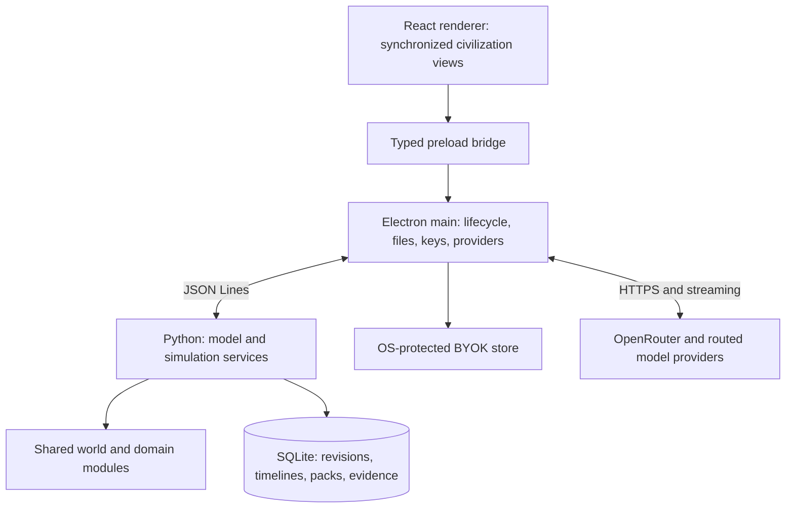

# Society Sandbox — Global Technical Architecture and Specification

Revision 0.2 · 2026-10-13

**Scope:** the complete application's technical architecture, covering all twelve domains, all supported scopes, coupled simulation, interviews, matrix exploration, AI/BYOK, persistence, extension, and desktop operation.

**Companion:** [Global game design architecture](DESIGN.md).

This is a specification for a new system. Requirements and contracts below describe intended behavior; they are not claims that an application, provider adapter, or numerical model has already been implemented. Implementation sequencing and domain work packages are outside this document.

## 1. System responsibilities

The application consists of four cooperating subsystems:

1. **Desktop and presentation:** navigation, interviews, visualizations, input, file operations, and lifecycle.
2. **Society model and simulation:** shared world state, mechanisms, arithmetic, transitions, constraints, evidence, and explanations.
3. **History and storage:** design revisions, timelines, branches, model identity, sources, reports, and portable saves.
4. **AI assistance:** BYOK, provider capabilities, contextual interviews/explanations, proposals, tools, usage, and transcripts.

Their common contract is a versioned civilization state and model identity. A view, assistant message, or result always identifies the revision, scope, and time it describes.

## 2. Technology and process architecture

| Layer | Selection | Responsibility |
|---|---|---|
| Desktop host | Electron, Electron Forge, Vite | Window lifecycle, preload, process control, secure settings, networking, dialogs |
| Presentation | React, TypeScript, semantic HTML, CSS | Interviews, world views, atlas, matrix, timeline, comparison, inspectors |
| Query state | TanStack Query plus local React state | Revision-keyed queries and unsaved UI selections |
| Charts | Recharts and accessible HTML tables | Indicators, distribution and timeline views |
| Model runtime | Python 3.12, Pydantic 2, Decimal | Typed model, deterministic arithmetic, validation, simulation, traces |
| Persistence | SQLite through Python | Transactional local history and model archives |
| IPC | Versioned JSON Lines over child stdio | Typed desktop/engine requests, results, progress, cancellation |
| AI providers | TypeScript adapters in Electron main | OpenRouter and capability-aware BYOK connections |
| Desktop packaging | PyInstaller engine bundle plus Forge resources | Native application with bundled Python |

Use Node 24 LTS for development. Choose compatible supported stable Electron/Forge/Vite versions at dependency initialization and pin exact releases in the lockfile. Python dependencies use `uv` with a frozen committed lockfile. Version changes are reviewed against the engine/model compatibility contract.

This stack requires no web backend, localhost HTTP server, container infrastructure, message broker, vector database, or graph database. SQLite stores graph entities and edges; Python evaluates them; the renderer presents them.



The renderer uses `nodeIntegration: false`, `contextIsolation: true`, and `sandbox: true`. It has no direct filesystem, provider, database, or child-process access. Preload exposes named methods and events, not arbitrary Electron IPC.

Main launches one engine by absolute path without a shell. Development uses the managed Python environment; packaged builds use the bundled native executable. Python owns simulation arithmetic, measurement/target calculations, numerical comparisons, and database writes. TypeScript formats results and handles network protocols; it does not implement parallel copies of society formulas.

## 3. Logical system components

| Service | Responsibility | Boundary |
|---|---|---|
| Catalog | Domain tree, questions, options, templates, source lineage | Contains content; no implicit simulation authority |
| World model | Scopes, cohorts, institutions, assets, relationships, boundary conditions | Single canonical representation across domains |
| Mechanism registry | Validated transformations, allocations, procedures, transitions, solver definitions | Executable Python or validated declarative definitions |
| Dependency compiler | Active relationships, typed ports, numerical graph, cycle classification | Documentary edges are distinct from numerical dependencies |
| Evaluation | Static design consequences and account/constraint evaluation | Pure computation from explicit inputs |
| Timeline | Scheduled events, state transitions, stochastic realization, replay | No wall-clock dependency in simulation state |
| Measurement | Indicators, distributions, thresholds, coverage, player targets | Observes model results; targets cannot mutate physics |
| Explanation | Calculation traces, provenance, affected-decision links | Machine-readable evidence consumed by UI and AI |
| History | Revisions, branch lineage, snapshots, model migrations | Immutable committed state |
| Assistant | Grounded context, proposals, read-only tools, transcripts | Cannot commit game changes or execute generated code |

The twelve domains are modules within this system, not independent applications. Their mechanisms use these services and share entity identities, units, stocks, capacities, and institutional relationships.

## 4. Canonical world ontology

### 4.1 Entities and relationships

| Entity | Key properties |
|---|---|
| Civilization | Identity, model configuration, scope membership, external boundary interfaces |
| Scope | ID, kind, membership, spatial extent where relevant; not necessarily a geographic container |
| Location/region | Geography, connections, environmental accounts, infrastructure membership |
| Population cohort | Count, modeled attributes, location/membership, needs, capacities; no assumed individual simulation |
| Household/community arrangement | Membership or aggregate counts, obligations, access rules, participation mechanisms |
| Institution | Actors/roles, jurisdiction, procedures, authority, obligations, capacity, oversight |
| Asset/network | Capacity, lifecycle, construction/maintenance requirements, location and connection topology |
| Resource/service | Quantity or capacity definition, unit, conversion rules, access interfaces |
| Account | Stocks/flows/claims, allocations, shortages, constraints, scope and time basis |
| External interface | Counterparty or boundary, finite capacity, terms, schedule, behavior assumption |
| Decision | Scoped question, alternatives, selection, rationale, mechanisms, evidence |
| Event | Effective time, preconditions, payload, origin, affected scopes, realized outcomes |

Relationships are typed and independently versioned: containment, geographic overlap, cohort membership, jurisdiction, ownership, obligation, supplies, consumes, access, connectivity, information channel, and source supersession.

Containment is acyclic. Jurisdiction and network graphs may overlap or cycle. Membership-based aggregation must declare weights or partitions so overlapping scopes do not double-count people or resources. A watershed and a political region can observe the same water account; they cannot each create another copy of its stock.

### 4.2 Scope and inheritance

Scope kinds include household, community/local, settlement, region, civilization, and global/external. A rule may target an explicit entity, membership set, or supported scope class.

Policy inheritance is defined by the mechanism, not by a universal “most local wins” rule. A rule declares whether it is exclusive, composable, a floor/ceiling, or delegated. Overlapping incompatible authority or parameter bindings produce a conflict finding until an explicit resolution rule applies. The engine cannot pick a winner from ordering in a JSON file.

### 4.3 State partitions

Canonical state separates conditions, chosen design, assumptions, dynamic state, observations, and goals. These partitions have distinct provenance and mutation rules. In particular, changing a goal cannot change an allocation, hazard probability, population, or resource stock.

Population may be an input, an evolving state, or a derived capacity bound under an explicitly selected model. The engine records which role is in use; it does not simultaneously treat population as fixed and solved.

## 5. All-domain module architecture

Each domain module declares definitions, input/output ports, supported scopes, owned state, mechanisms, measurements, evidence, and missing coverage. It proposes state changes through the engine's transaction/reduction service; it never writes another module's state directly.

| Domain module | Definitions/state it contributes | Principal interfaces |
|---|---|---|
| `provisioning` — I | Production/transformation, stock and goods movement, use, recycling | Shared resources, labor, land, assets, access/allocation, environment |
| `economy` — II | Exchange/ownership, transaction and entitlement accounts, work/allocation procedures | Resource access, labor/time, institutional rules, household/cohort distributions |
| `governance` — III | Authorities, decision procedures, delegation, oversight, representation | Jurisdiction, institutional capacity, law, information, all policy mechanisms |
| `law_conflict` — IV | Rights/claims, adjudication, enforcement and agreement procedures | Authority, entitlement, case/service capacity, external interfaces |
| `social_organization` — V | Household/community arrangements, care obligations, cohort participation | Population/time budgets, services, access, identity and institutions |
| `knowledge_culture` — VI | Learning/research/cultural service mechanisms, skill stocks and access | Labor capacities, communication, institutions, technology assumptions |
| `health` — VII | Health/care needs and capacity, exposure/transition models where defined | Cohorts, environment, provisioning, services, infrastructure, information |
| `infrastructure` — VIII | Assets/networks, housing, construction, maintenance, service connectivity | Resource and labor claims, geographic reach, lifecycle and risk |
| `communication` — IX | Channels/access/control, disclosure/privacy, modeled information delay | Decision procedures, education, health, coordination, identity |
| `environment` — X | Ecological stocks, regeneration, emissions/sinks, exposure and land constraints | Production, infrastructure, health, risk, physical boundary conditions |
| `meaning_identity` — XI | Declared commitments, membership/participation and accommodation rules | Community, culture, governance, rights; explicit indicators or qualitative findings |
| `security_risk` — XII | Hazard processes, exposure, prevention, continuity and response mechanisms | All capacities/obligations, infrastructure, health, external conditions |

Ownership concerns definitions and state authority, not separate data copies. For example, infrastructure owns an asset's capacity/lifecycle; provisioning demands its energy; economy defines payment/access rules; governance assigns authority; risk defines exposure. These references identify the same asset.

### 5.1 Module contract

Every mechanism definition provides:

- Stable ID, version, domain classification, supported scope and entity types.
- Typed required inputs, outputs, units, and owned state variables.
- Preconditions and explicit coverage/missing-input behavior.
- Static evaluation and/or transition procedure.
- Resource, service, population, and time claims it creates.
- Policy precedence/composition semantics where applicable.
- Evidence and assumption references.
- Trace and diagnostic definitions.
- Validation fixtures and applicable conservation/boundedness properties.

Shared reducers commit accepted transitions together. A domain cannot independently spend capacity already allocated elsewhere. Group distributions, stocks, actor obligations, and authority relationships remain consistent across module views.

### 5.2 Behavioral and institutional models

An institutional procedure can be executable without a universal social score: eligibility, deliberation steps, case queues, capacity, voting/consensus procedures, publication obligations, and enforcement rules are explicit mechanisms.

Behavioral response models specify the population represented, rule, parameters, time basis, evidence, and uncertainty. They do not acquire empirical credibility through schema validation alone. Unsupported human effects remain qualitative requirements or hypotheses attached to the same graph.

## 6. Content, evidence, and mechanism definitions

### 6.1 Versioned packs

A pack contains a manifest, domain/branch definitions, questions/options, mechanisms, parameters, measurements, dependency declarations, source excerpts, licenses, and validation fixtures. Its manifest identifies format version, pack version, engine compatibility, source revisions, dependencies, and a digest of all files.

Separate identities exist for application, schema, catalog, model/rules, and numeric runtime. Saves pin the combination that produced them. The `society` repository is one source corpus; its detailed production/logistics work does not restrict supported domain modules.

Source decision IDs are citations, not database primary keys. Game IDs are namespaced and distinguish compound questions/subquestions. Original full alternatives, adopted/superseded lineage, source commit, and source status are preserved. Document-maintenance decisions are classified as provenance.

### 6.2 Authored and generated content

Content origin is authored, imported, player-proposed, or AI-proposed. Modeling status is numerical, procedural, qualitative, partial, or unsupported. Evidence status is a separate axis. A historical adopted option can have incomplete model coverage.

The runtime supports question templates and proposed alternatives. A proposal may reference validated mechanism IDs and typed parameter assignments; if compatible, the engine can preview it. Unknown mechanisms remain qualitative drafts with explicit gaps. No generated Python, shell command, or arbitrary text formula is executed.

Arithmetic definitions use trusted Python registry functions or a bounded declarative expression graph with registered operators and unit checking. The expression graph is data, not `eval`. Its successful parsing proves structural validity, not scientific validity. Activation in a model requires the same evidence and independent validation as any authored rule.

### 6.3 Evidence contract

`SourceRef` records repository/document identity, immutable revision, location/section, excerpt digest, license, and historical status. `AssumptionRef` records scope, parameter/behavior definition, origin, uncertainty form, and rationale. Outputs link to both.

Amendments are resolved through explicit supersession links. Old integration verdicts are not imported as current truth when later decisions supersede them. Arithmetic copied from a document is independently checked for units, time factors, denominators, and overlapping claims before it becomes executable.

## 7. Arithmetic and coupled evaluation

### 7.1 Quantities and units

Authoritative quantities use Decimal, fixed 28-significant-digit local contexts, and round-half-even. Inputs are parsed from decimal strings, never binary floats. Unit definitions cover dimensions, scale factors, time bases, and denominator populations/groups. Display rounding is separate from stored precision.

```json
{
  "value": "125.0",
  "unit": "L/person/day",
  "scope_id": "region:north",
  "provenance": "player_input",
  "assumption_refs": []
}
```

The unit registry is extensible across all modules. It distinguishes stocks, flows, capacity, time, counts, money/entitlements, and derived indicators. Money is not a physical resource conversion factor unless a mechanism explicitly defines a transaction. Unknown units, invalid dimensions, NaN, Infinity, and invalid denominator populations fail structural validation.

### 7.2 Dependency graph and solver boundaries

Compile active numerical relationships into a graph of mechanism instances and typed ports. Evaluate acyclic components in stable topological order. Detect strongly connected components and handle them only through a declared solver contract.

Supported solver classes are explicit finite allocation, linear systems using deterministic Decimal elimination, and bounded iterative mechanisms with declared update order, starting state, convergence criterion, tolerance, and iteration limit. A coupled component without an applicable solver is unresolved; an iteration that fails to converge returns a solver failure. No undocumented single-pass approximation substitutes for an equilibrium.

Policy conflicts and documentary relationships occupy separate graphs. They can have cycles without requiring a numerical equilibrium solver. Stable IDs resolve computational ordering, never political precedence.

An optional capacity-bound calculation can solve a designated input, such as supported population, under declared monotone constraints. The selected problem states which variable is solved and what is fixed. It is a feasibility calculation, not an implicit social objective or optimizer.

### 7.3 Global evaluation pipeline

`evaluate(world, design, assumptions, model_identity)` is pure: no database, network, wall clock, provider call, or hidden random draw.

1. Validate identities, scope, units, rule availability, and structural inputs.
2. Resolve active mechanisms, policy composition, and explicit conflicts.
3. Compile the typed calculation graph and solver components.
4. Evaluate independent and coupled components.
5. Construct shared capacity/resource/service accounts and resolve supported allocations.
6. Compute group/scope distributions, constraints, and coverage.
7. Evaluate measurements and separately observe optional player targets.
8. Produce typed findings, trace graph, provenance, and canonical result identity.

Required missing input propagates incomplete status to dependent outputs while independent components continue. A physically insufficient but structurally valid design returns results and shortages. Unknown allocation precedence produces unresolved allocation, not a winner selected by file order.

### 7.4 Conservation and shared budgets

Accounts identify each supply, claim, transformation, reservation, allocation, loss, and external transfer. Subtotals declare their members and cannot be added again beside them. Each stock/capacity is shared by stable ID.

For each conserved stock:

```text
opening + inflows = closing + outflows + explicit losses
```

Actual allocations cannot exceed available capacity. Unmet requests remain explicit; negative inventory is never hidden through clamping. Conversions specify yields, residual products, losses, and dimensions. A reservation is deducted once. An export withdrawal is distinct from local consumption.

Equivalent rules apply to population/time budgets, service capacity, network throughput, entitlements, and case queues where their mechanisms define accounting invariants. Monetary, ecological, and social quantities do not all share the same conservation law; each model states its invariants.

### 7.5 Uncertainty and reproducibility

Parameters can be point values, bounded ranges, or explicitly defined distributions. Source ranges are not silently converted into midpoints or probabilities. Sensitivity comparisons enumerate chosen parameter variants; probabilistic experiments require a declared distribution and sampling rule.

Random mechanisms receive isolated deterministic random streams identified by experiment seed, mechanism, scope, and event index. Stream identity prevents unrelated module changes from shifting another module's random sequence. Store numeric runtime/RNG version and realized draws or events for replay. AI generation is excluded from simulation randomness.

Canonical serialization normalizes decimals, sorts unordered structures, preserves semantic order, and excludes timestamps/request IDs. Results include input, model, event-realization, and output digests. Reproduction requires the exact numerical/model runtime, not merely a source repository commit. Supported-platform checks verify the claimed reproducibility boundary.

## 8. Time, transitions, and experiments

The timeline uses integer simulation-day boundaries with a declared calendar convention. Mechanisms have schedules and update intervals: daily services, weekly delivery, seasonal production, annual demographic or budget updates, and explicit dated events can coexist.

Stocks and rates convert through the unit/time registry. Fast-forward executes all necessary transition boundaries; it cannot skip daily shortages because the interface displays yearly results. A model can register an exact aggregate transition only when its equivalence and applicability are defined.

At a transition boundary:

1. Apply due external events and policy changes according to documented event precedence.
2. Resolve active mechanisms against the opening state and newly effective configuration.
3. Compute proposed transitions and shared demands.
4. Resolve finite capacities and conflicting proposals through registered rules.
5. Commit the combined transition atomically in simulation memory.
6. Validate invariants and record traces, events, findings, and closing state.

Construction, aging, replenishment, degradation, education, health, migration, institutional processes, and risk response are transition classes supported by this framework. Their actual behavior comes from selected models, not universal defaults. Missing transition mechanisms remain visible coverage gaps.

Design revision and effective timeline change are different entities. A future policy change references the approved revision and an effective time. Retrospective changes fork history. Experiments can start from a design and explicit opening state or fork an existing simulation snapshot.

Each experiment records opening state, model identity, assumptions, event schedule, seed/realization, and checkpoints. Work executes in cancellable chunks; cancellation never commits a partial transition. Resource/time quotas are runtime safeguards, not arbitrary narrative horizons.

## 9. Measurements, goals, and explanations

An indicator definition identifies its formula/procedure, inputs, unit, scope, aggregation, time basis, coverage, and interpretation. Its diagnostics have named thresholds and provenance. No universal positive direction or warning margin is assumed.

Results distinguish `known`, `partial`, `missing_input`, `unmodeled`, `conflict`, `solver_failure`, and `not_applicable`. Findings distinguish physical shortage, selected-policy breach, institutional gap, uncertainty, and player-target observation. Partial coverage cannot produce an unqualified whole-system sufficient result.

Player goals are narrative questions or typed metric comparisons; their default set is empty. They are evaluated against results after simulation and cannot affect it. No aggregate score or automatic policy ranking exists.

A trace node records mechanism/version, typed inputs, result, child dependencies, scope/time, and source/assumption references. Trace graphs are pageable and shared across views. The engine provides both machine-readable traces and authored message templates. AI explanations reference these objects rather than replace them.

## 10. Application services and IPC

### 10.1 Protocol

Engine stdin/stdout carry versioned UTF-8 JSON Lines. Stdout is protocol only; safe diagnostic logs use stderr. Requests have IDs, operation, typed parameters, and protocol version. Responses are success/results or stable error codes; progress/events identify their originating operation.

```json
{
  "protocol": 1,
  "id": "request:42",
  "operation": "design.preview",
  "params": {
    "civilization_id": "civ:1",
    "branch_id": "branch:a",
    "base_revision_id": "revision:17",
    "changes": [{
      "kind": "select_option",
      "decision_instance_id": "decision:community-care:north",
      "option_id": "option:shared-service"
    }]
  }
}
```

IDs illustrate the global contract, not a prescribed civic policy. A valid incomplete or infeasible design is a successful operation with findings. Structural validation, stale revision, unavailable model, database failure, and protocol failure are operation errors.

Pydantic defines contracts; generated JSON Schema supplies TypeScript types and AI-tool schemas. Main validates both renderer and engine messages. A 1 MiB message limit and paginated/chunked payloads bound transport; large traces, world slices, packs, and exports are not single unbounded messages.

### 10.2 Service surface

| Group | Required operations |
|---|---|
| Runtime | Handshake, health, progress, cancellation, shutdown |
| Catalog/model | List domains/branches/questions, inspect options/mechanisms, validate packs, read coverage/sources |
| World | Create/open, inspect scopes/entities/topology, preview condition or structure changes |
| Design | Evaluate, preview, apply, read trace, inspect conflicts and obligations |
| History | List revisions, undo/redo, fork/rename, compare, migrate-model branch |
| Timeline | Create/fork experiment, schedule approved changes/events, advance/pause/replay, read snapshots/results |
| Exploration | Query atlas, aggregate matrix, drill relationships, read group distributions |
| Goals/notes | Preview/apply target or note changes; query observations |
| Content proposals | Create/validate proposal, classify coverage, preview compatible mechanisms |
| Portability | Validate/import, prepare export/report, stream archive/data |
| Assistant context | Read scoped facts, compare, preview, retrieve excerpts, store turns and usage |

Preload exposes explicit allowlisted methods. There is no arbitrary operation-string forwarder, shell execution, SQL, filesystem read, or authenticated URL fetch available to renderer content.

### 10.3 Preview and commit

Preview reconstructs a candidate from an immutable base revision and typed changes. It returns the candidate identity, affected scopes, evaluated differences, findings, and trace links without creating a committed revision.

Apply includes the complete change payload, candidate digest, base revision, and operation ID. Python revalidates and checks the candidate and current branch head, then writes the revision/events/results and advances the head in one transaction. Stale candidates return a revision conflict. Idempotent operation IDs resolve uncertainty after IPC loss without creating duplicate decisions.

AI proposals use the same preview contract. Only a player's application command can commit them.

## 11. Storage, history, and portability

### 11.1 Local database

Python is the sole SQLite writer; Electron enforces one application instance per data directory. The database resides under the application user-data path. Enable foreign keys, WAL, explicit transactions, and durable user commits. Use SQLite's backup API before schema migrations.

| Record family | Stored information |
|---|---|
| Civilizations and scopes | Identity, topology, membership, external boundaries |
| Catalog/model archives | Immutable content, rules/version identities, schemas, evidence, digests |
| Design revisions/events | Canonical input snapshots, parent links, selected choices, offered alternatives, rationale |
| Branches | Named heads and lineage, preserved alternate futures |
| Evaluations/traces | Revision/model-keyed derived caches and output identities |
| Experiments | Opening state, model identity, schedules, random-stream identity |
| Timeline events/checkpoints | Effective changes, transitions, realized hazards, replay state |
| Measurements | Scope/time results and distributions, coverage and provenance |
| Goals/notes/proposals | Player purpose, annotations, proposed content and status |
| Assistant records | Revision-scoped turns, provider/model metadata, reported usage; no keys |
| Migrations | Schema transitions and backup/recovery metadata |

Committed revisions are immutable. Complete design-input snapshots simplify reads; event history preserves explanations. Timeline checkpoints plus ordered events provide replay. Derived caches can be discarded without losing authored state or history.

Undo moves a branch head. Editing after undo preserves the old future as another branch. No branch disappears through automatic cleanup. Model updates create an explicit migrated branch; old results and choice sets remain historical evidence.

### 11.2 Portable civilization

A versioned portable archive contains manifests, input states, choices and alternatives, branch lineage, experiments/events, assumptions, model/content identities, source attribution, and optional cached results. It contains data, not executable engines or generated code.

Import validates schemas, relationships, compatible mechanisms, hashes, path safety, entry types, decompression budgets, and duplicates before one database transaction creates the imported civilization. Limits are configurable application safeguards. Imported executable content, traversal paths, symlinks, and arbitrary formula code are rejected.

If the required historical engine/model is unavailable, the archive can be inspected in a historical read-only mode. New computation requires an explicit compatible model or migration; stored results are not advertised as freshly reproduced.

Exports omit keys and encrypted-key blobs always. Transcripts, private notes, and attachment material have explicit inclusion controls. Reports and CSVs include scopes, time bases, model identities, units, coverage, sources, and assumptions.

## 12. Presentation and exploration architecture

The renderer's selection context is civilization, branch, revision or timeline state, scope, and view. Query keys include that context and model identity. Temporary card selections and filters remain local UI state; authoritative society state comes from Python.

Shared components include interview cards, quantity/coverage displays, diagnostic bars, scope selector, account/trace inspector, source viewer, alternative comparison, relationship lists, and assistant panels. Domain-specific views compose these components rather than implement their own arithmetic or persistence.

Matrix data is a sparse set of typed relationships. Python aggregates it by domain, branch, decision, scope, or selected alternatives. The renderer virtualizes large lists/cells and supports accessible list equivalents. Relationship count, active state, coverage, and numerical magnitude are separate fields.

World topology, authority networks, and branch lineage are projections of the same entity/edge store. Diagram layouts are presentation only and cannot create semantic relationships. Any layout randomness is separately seeded and excluded from simulation identity.

Numerical comparisons require compatible dimensions, scopes, aggregation, time basis, and model semantics. The engine determines comparability; the UI does not subtract unrelated bar values. Distribution views preserve group/local detail alongside aggregates.

## 13. AI/BYOK and full OpenRouter architecture

### 13.1 Provider layer

OpenRouter has a dedicated adapter with model discovery, authenticated key status, generation, streaming, provider routing, capabilities, usage, and diagnostics. Support is not implemented as a generic base-URL substitution.

Provider profiles contain endpoint identity, selected model, generation/routing preferences, capability settings, and an encrypted-key reference. A separate OpenAI-compatible adapter may support other BYOK endpoints through their declared capabilities; OpenRouter controls are never assumed valid elsewhere.

The application consumes current provider capability metadata and preserves unknown metadata for forward compatibility. Model IDs are not a hardcoded enum. A model's support for text, image, audio, video, structured output, reasoning, tools, and context limits governs the corresponding UI and request construction.

### 13.2 OpenRouter support contract

| Capability | Required integration |
|---|---|
| Keys and account | User key entry/test/replace/remove; safe authenticated key-status and limit information |
| Models | Full catalog discovery, variants, search, price/context/capability details, refresh and timestamped cache |
| Routing | Provider ordering/filtering, fallbacks, supported-parameter enforcement, supported price/privacy/data-use preferences |
| Generation | Streamed and nonstreamed requests, sampling/output controls, response formats, reasoning controls, finish reasons |
| Tools | Capability-aware schemas, streamed fragmented/parallel tool calls, results and continuation |
| Structured responses | Provider-supported schema/JSON modes with application-side validation |
| Reasoning | Separate visible metadata where supplied; preservation of opaque continuation details where required |
| Modalities/attachments | Typed provider-supported content, capability checks, context/size accounting, explicit file/data sharing |
| Usage | Input/output/cache/reasoning tokens where reported, actual/estimated cost distinction, generation metadata |
| Failure and cancellation | Auth/credit/rate/model/provider errors, partial streams, abort, safe deliberate retry |
| Model/provider changes | Route metadata, capability revalidation, compatible history or explicit new thread |

Requests target the documented OpenRouter HTTPS API, normally `https://openrouter.ai/api/v1`, using catalog, chat generation, key-status, generation-metadata, and model/provider metadata endpoints as applicable. Current endpoint/parameter schemas are verified during provider implementation and integration validation rather than inferred from OpenAI compatibility.

The typed request builder supports current documented provider preferences, including order/only/ignore, fallback behavior, parameter support, supported privacy/data-retention preferences, price/routing preferences, and documented generation controls. It must not silently drop a selected control. Unknown or unsupported preferences produce explicit capability or provider errors.

Model fallback requires an explicit profile setting; actual provider/model identity is reported on replies when available. Catalog visibility does not imply a model is suitable for every task or modality. The application negotiates capability rather than reducing the entire provider to a text-only fixed model interface.

### 13.3 Keys and networking

Keys are entered through a temporary field, transferred once to main, and cleared. Main never returns stored keys to renderer or supplies them to Python. Store encrypted blobs using Electron safeStorage backed by the OS credential protection. If secure protection is unavailable or Linux reports `basic_text`, use session-only memory storage instead of a plaintext fallback.

Main performs provider networking through Electron's network stack with supported system proxy behavior. Bind credentials to the chosen endpoint/profile and prevent cross-host authenticated redirect forwarding. Custom endpoints require explicit configuration; non-loopback plaintext endpoints are rejected.

Logs, reports, crash diagnostics, archives, prompts, engine environments, and renderer APIs exclude keys and authorization headers. Key removal cancels related requests and deletes stored material. OS-account compromise remains outside the protection provided by local encrypted storage.

### 13.4 Assistance and mutation boundary

Each assistant turn references a design revision or simulation checkpoint, selected scope, task, provider/model/routing profile, and bounded context manifest. Python assembles relevant choices, accounts, traces, mechanisms, findings, sources, and assumptions. Sharing private notes, attachments, unrelated branches, or broader context requires explicit user inclusion.

Assistant roles include interview clarification, question adaptation, dependency exploration, branch comparison, source explanation, and structured alternative proposal. Generated alternatives carry origin and evidence/coverage status.

Tools can read facts, inspect definitions/traces, compare existing states, validate proposals, and request noncommitting previews. No assistant tool can apply a decision, alter model code, mutate a timeline, run arbitrary code, access arbitrary files/URLs, or obtain a key.

Tool arguments are schema-validated and bound to the turn's immutable context. A proposed change becomes an ordinary inspectable UI preview. The player applies it through the validated desktop action path. Generated numbers in prose never update state; authoritative widgets render Python results.

Models without tools can explain supplied context; this limitation is visible. Models with tools and structured output use the supported contract. Incomplete capabilities cannot be concealed by pretending a calculation or tool call occurred.

Changing branches during streaming leaves the reply attached to its original state. Changing models preserves compatible messages but does not forward incompatible private reasoning payloads. Start a new thread when continuation cannot safely be translated. Opaque reasoning details are not fabricated, interpreted as simulation state, or exposed as a guarantee of correct explanation.

### 13.5 Streaming, modalities, and spend

Incremental SSE handling supports arbitrary chunk boundaries, content/reasoning deltas, usage-only events, indexed tool fragments, errors, termination, and finish reasons. Complete and validate a tool call before executing it. Apply bounded tool rounds/calls and context limits as configurable runtime safeguards.

Typed multimodal parts use provider/model-compatible representations. An attachment has provenance, MIME/type, size, selected sharing scope, and retention controls. Local parsing can produce source excerpts; provider-side file processing occurs only through explicit sharing. Unsupported modalities, file processing, or output renderers are surfaced before sending rather than silently discarded. Returned nontext artifacts remain separate from simulation results.

Abort requests on cancellation and preserve partial/cancelled status. Cancellation cannot guarantee zero further upstream charge. Do not automatically regenerate a paid turn after acceptance is uncertain or output/tools have begun. Read-only metadata requests may use bounded retry; generation retries are deliberate user actions.

Usage records separate catalog estimates, provider-reported usage/cost, unresolved usage, and cancelled-request observations. Python performs Decimal cost aggregation. A later actual cost replaces the estimate for that request rather than becoming a second charge. Unknown cost is not zero.

Local per-turn/session gates constrain new requests; account-side OpenRouter limits provide hard budget control where supported. An in-flight request can exceed a local estimate. Privacy/data-use preferences are passed through supported routing controls; incompatible routing cannot be silently loosened.

Authored/core offline functionality remains independent of the provider. Transcripts are local optional records and can be deleted independently of civilization history.

## 14. Trust, lifecycle, and failure behavior

Use a restrictive Content Security Policy and no renderer remote scripts or provider requests. Sanitize rendered Markdown/source/AI content. Block arbitrary navigation/windows; validated external source links open through main in the system browser.

Imported content and AI output are untrusted data. Content packs cannot execute Python, JavaScript, SQL, or shell. Trusted new mechanisms require code review, versioning, evidence, and validation before registration; generated mechanism proposals cannot bypass this boundary.

Main waits for a versioned engine handshake. Protocol mismatch prevents edits but preserves readable saved state. On engine crash, reject pending calls, retain the last confirmed revision, and support restart/reconnection. SQLite transactionality plus operation IDs resolve uncertain commits. No recovery path resets a civilization automatically.

On close, cancel network work, complete or roll back short persistence transactions, request engine shutdown, and enforce a bounded termination timeout. Disk-full/save failure leaves the preview visibly unsaved. Provider failure leaves simulation/history intact. Solver failure leaves its dependent outputs unresolved while independent outputs remain usable.

## 15. Extension, performance, and platform operation

Domain extension uses the same module contract, shared accounts, scopes, units, trace system, and validation rules. A new pack can add questions or compose validated mechanisms without changing desktop architecture. A genuinely new calculation or behavioral mechanism extends the trusted Python registry under a new model identity.

Performance scales through scope/world queries, sparse dependency storage, content/result pagination, cancellable simulation chunks, checkpointing, virtualized presentation, and dependency-aware caching keyed by complete inputs/model identities. Caching cannot treat two states as equivalent because their visible bars happen to match.

Independent components may compute concurrently if their results are merged in deterministic order and they do not share mutable state or random streams. State reduction and SQLite commits remain serialized. Solver budgets and memory limits return explicit outcomes, not truncated unlabelled calculations.

The application targets native Windows x64, macOS arm64/x64, and Linux x64 bundles. Build the Python engine natively for each target and package it as executable resources outside ASAR. Users need no system Python. Signing/notarization, Linux secure-key-backend behavior, engine path resolution, portable data, and numerical reproducibility are platform validation requirements.

The application code belongs in its own repository. A suitable structure separates `desktop/main`, `desktop/preload`, `desktop/renderer`, `engine/world`, `engine/domains`, `engine/simulation`, `engine/storage`, `engine/explanation`, `content`, `contracts`, and tests. The source society repository remains a referenced corpus, not the application's dependency root.

## 16. Architecture validation

Validation concerns the entire system's contracts:

| Area | Required evidence |
|---|---|
| Domain integration | Every domain registers through the same contract; representative cross-domain effects share entities/accounts |
| Scopes | Overlapping jurisdictions/membership, local variation, and aggregate views avoid duplication |
| Arithmetic | Independent fixtures, units/denominators, conservation, finite allocation, boundary conditions, coupled-solver behavior |
| Time | Multirate ordering, effective changes, lifecycle transitions, event scheduling, replay and checkpoint equivalence |
| Reproducibility | Canonical identities, exact runtime/model binding, independent random streams, supported-platform checks |
| Coverage | Unknown differs from zero; partial differs from sufficient; institutional and numerical conflicts stay distinct |
| Goals | Empty by default; changing goals never changes world/simulation outcomes |
| History | Preview purity, stale apply rejection, idempotent recovery, retained alternate futures, explicit model migration |
| AI/OpenRouter | Catalog/routing/capabilities, fragmented streaming, tools, modalities, errors/cancellation, usage, redaction and secure keys |
| Security | No renderer privileges, unsafe content execution, key leakage, archive traversal, or assistant commit pathway |
| User interface | Synchronized scope/time, accessible interviews/matrix, inspectable traces, compatible comparisons |
| Portability | Offline open/export/import, immutable pack identity, no-system-Python operation, platform recovery |

Use pytest for Python invariants and independent fixtures, Vitest for desktop/provider contracts, and Playwright for Electron interaction and packaged smoke checks. Mock provider tests require no paid key. Live OpenRouter compatibility tests are explicit, bounded, and cover authenticated metadata, representative generation/streaming/tools/modalities, routing preferences, cancellation, and usage. Untested capabilities are reported as untested.

Structural validators cannot certify a social model's validity. Model review also examines operational definitions, evidence, uncertainty, distributional coverage, and unsupported extrapolation. Usability review checks that a player can identify a consequence, locate its assumption, and distinguish their preferences from the application's diagnostics.

## 17. Global architecture decisions

| Decision | Consequence |
|---|---|
| Local Electron application with Python engine | Conventional desktop delivery with independently inspectable computation |
| Shared world and twelve domain modules | Whole-civilization coupling without twelve duplicated simulators |
| Scope/entity relationships independent of domain classification | Geography, membership, authority, and local variation can overlap |
| Registered mechanisms plus validated declarative composition | Extension is possible without executing arbitrary imported/generated code |
| Deterministic numeric/transition contracts | Results can be traced and replayed within explicit model/runtime boundaries |
| Separate design and timeline histories | Counterfactual design and historical transformation remain distinguishable |
| No built-in optimum or default goals | Measurements supply evidence for player judgment |
| First-class OpenRouter BYOK adapter | Provider features, routing, costs, capabilities, and privacy remain explicit |
| AI preview/proposal authority only | Generated assistance cannot silently mutate a civilization |
| Versioned evidence, model coverage, and source lineage | A source claim, a hypothesis, and a computed consequence remain distinguishable |

## 18. Source basis and reference status

The society map and working conventions were inspected in `playa77/society` at commit `9ff539997dbd1bd3fa99deabcf6bc5907602df60`. The game can import that corpus under the content/evidence contracts above. These architecture documents do not change its binding civic choices, branch documents, or global decision ledger.

Implementation references include [Electron security](https://www.electronjs.org/docs/latest/tutorial/security), [safeStorage](https://www.electronjs.org/docs/latest/api/safe-storage), [Electron Forge](https://www.electronforge.io/), [Python Decimal](https://docs.python.org/3.12/library/decimal.html), [SQLite backup](https://www.sqlite.org/backup.html), [PyInstaller](https://pyinstaller.org/en/stable/), and [OpenRouter documentation](https://openrouter.ai/docs/quickstart).

Live OpenRouter documentation retrieval in this environment returned a network-proxy denial; no key or provider generation was tested. Provider field/endpoint schemas must be confirmed against current official documentation and live compatibility checks when implemented. The architecture requires full capability-aware OpenRouter integration and does not claim that integration already exists.
